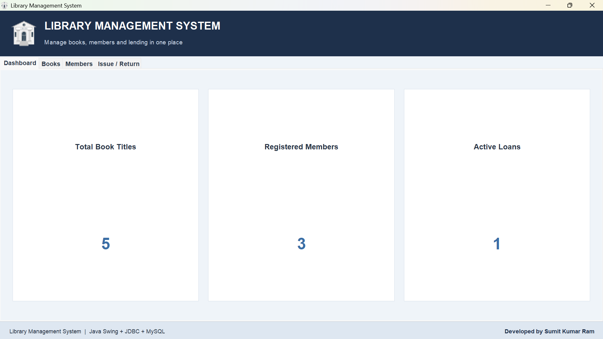
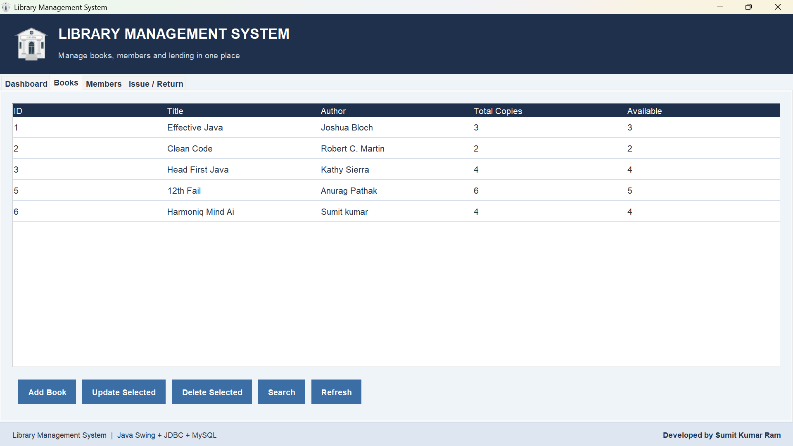
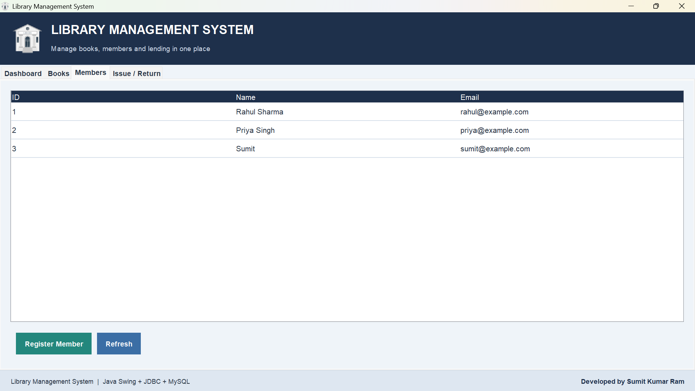
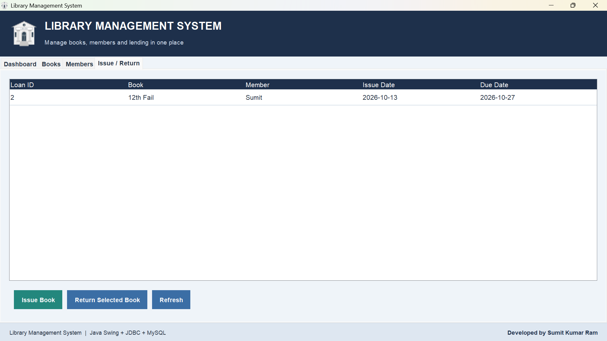

# Library Management System

A desktop-based **Library Management System** built with **Java Swing,
JDBC, and MySQL**. It provides a graphical interface for managing books
and members, issuing and returning books, and viewing active loans.

## Screenshots

### Dashboard



### Books



### Members



### Issue / Return



> Keep these image filenames and capitalization exactly the same in the
> `images` folder so GitHub can display them correctly.

## Features

-   Dashboard showing book titles, registered members, and active loans.
-   Add, view, search, update, and delete books.
-   Register members and view member records.
-   Issue books to registered members with a due date 14 days after
    issue.
-   Return books and update available-copy counts.
-   View active loans with book, member, issue date, and due date.
-   Persist records in MySQL.
-   Use JDBC prepared statements and transactions for issue/return
    operations.

## Technologies Used

-   **Java** --- application logic
-   **Java Swing** --- desktop graphical user interface
-   **JDBC** --- Java-to-MySQL connectivity
-   **MySQL** --- relational database
-   **Maven** --- dependency management
-   **IntelliJ IDEA** --- development environment

## Project Structure

``` text
LibraryManagementSystem/
├── images/
│   ├── library-logo.png
│   ├── book-logo.png
│   ├── Dashboard.png
│   ├── Books.png
│   ├── Members.png
│   └── Issue-return.png
├── src/main/java/com/library/
│   ├── DBConnection.java
│   ├── LibraryUI.java
│   └── Main.java
├── pom.xml
├── .gitignore
└── README.md
```

## Prerequisites

1.  JDK compatible with the project (the current local setup uses Java
    22).
2.  MySQL Server and MySQL Workbench.
3.  IntelliJ IDEA or another Java IDE.
4.  Maven support (IntelliJ can import the Maven project automatically).

## Database Setup

Open MySQL Workbench and run this SQL to create the database and tables
if they do not already exist:

``` sql
CREATE DATABASE IF NOT EXISTS library_db;
USE library_db;

CREATE TABLE IF NOT EXISTS books (
    book_id INT PRIMARY KEY AUTO_INCREMENT,
    title VARCHAR(150) NOT NULL,
    author VARCHAR(100) NOT NULL,
    total_copies INT NOT NULL DEFAULT 1,
    available_copies INT NOT NULL DEFAULT 1
);

CREATE TABLE IF NOT EXISTS members (
    member_id INT PRIMARY KEY AUTO_INCREMENT,
    name VARCHAR(100) NOT NULL,
    email VARCHAR(150) NOT NULL UNIQUE
);

CREATE TABLE IF NOT EXISTS loans (
    loan_id INT PRIMARY KEY AUTO_INCREMENT,
    book_id INT NOT NULL,
    member_id INT NOT NULL,
    issue_date DATE NOT NULL,
    due_date DATE NOT NULL,
    return_date DATE DEFAULT NULL,
    FOREIGN KEY (book_id) REFERENCES books(book_id),
    FOREIGN KEY (member_id) REFERENCES members(member_id)
);
```

If these tables already exist, do not rerun table-creation statements
unnecessarily. To inspect existing data:

``` sql
USE library_db;
SELECT * FROM books;
SELECT * FROM members;
SELECT * FROM loans;
```

### Optional sample records

Run these only if you need sample data. Existing records may cause
duplicate books or duplicate-email errors.

``` sql
INSERT INTO books (title, author, total_copies, available_copies)
VALUES
('Effective Java', 'Joshua Bloch', 3, 3),
('Clean Code', 'Robert C. Martin', 2, 2),
('Head First Java', 'Kathy Sierra', 4, 4);

INSERT INTO members (name, email)
VALUES
('Rahul Sharma', 'rahul@example.com'),
('Priya Singh', 'priya@example.com');
```

## Database Connection Configuration

The JDBC URL is:

``` text
jdbc:mysql://localhost:3306/library_db
```

Configure `src/main/java/com/library/DBConnection.java` to read the
username and password from environment variables:

-   `DB_USER` --- your MySQL username (often `root` locally)
-   `DB_PASSWORD` --- your local MySQL password

In IntelliJ, set these in **Run → Edit Configurations** for the
`LibraryUI` run configuration. Never commit your real password or other
secrets to GitHub. If a real password was previously pushed, change it
and clean the repository history before making the repository public.

## Run the Application

1.  Start MySQL Server.
2.  Open the project in IntelliJ IDEA and allow Maven to load.
3.  Confirm that `library_db` and its tables exist.
4.  Set `DB_USER` and `DB_PASSWORD` in the `LibraryUI` run
    configuration.
5.  Run `LibraryUI.main()` to launch the graphical application.

Run `Main.java` to launch the original console-based version.

## How to Use

1.  Open **Books** to add, search, update, or delete book records.
2.  Open **Members** to register and view members.
3.  Open **Issue / Return** and issue a book using an existing Book ID
    and Member ID.
4.  Select an active loan and use the return action to record a return.
5.  Use the refresh controls to reload records.
6.  Open **Dashboard** to view the current totals.

A loan is active when `return_date` is `NULL`. A book with loan history
may not be deletable because of database foreign-key constraints.

## Author

**Sumit Kumar Ram**

Developed as a Java + SQL project to demonstrate Java Swing UI
development, JDBC connectivity, relational database design, CRUD
operations, and transaction handling.

## License

No license is currently specified. Add a license file if you intend to
grant others explicit permission to reuse or redistribute this project.
